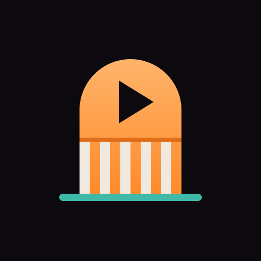
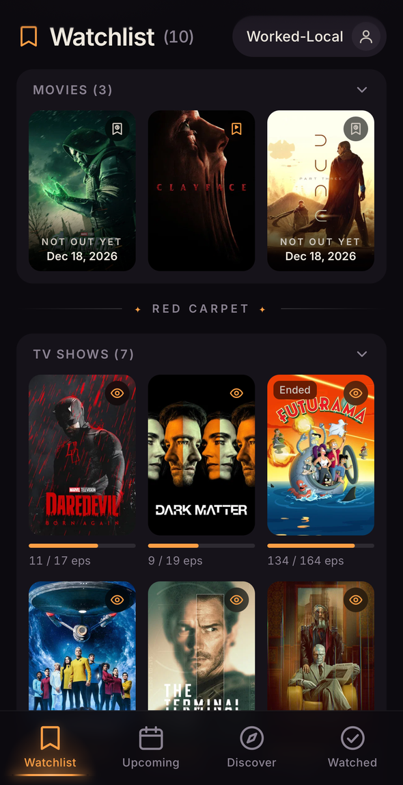
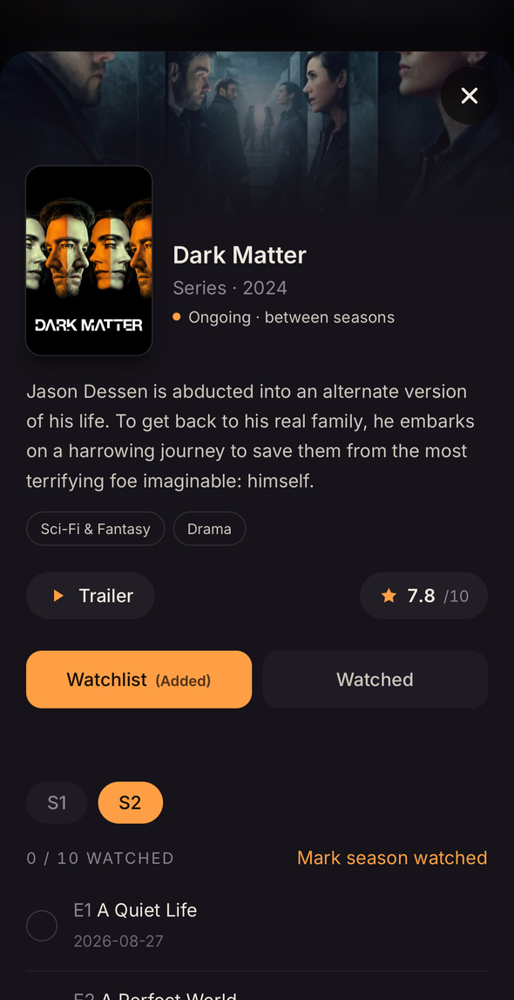
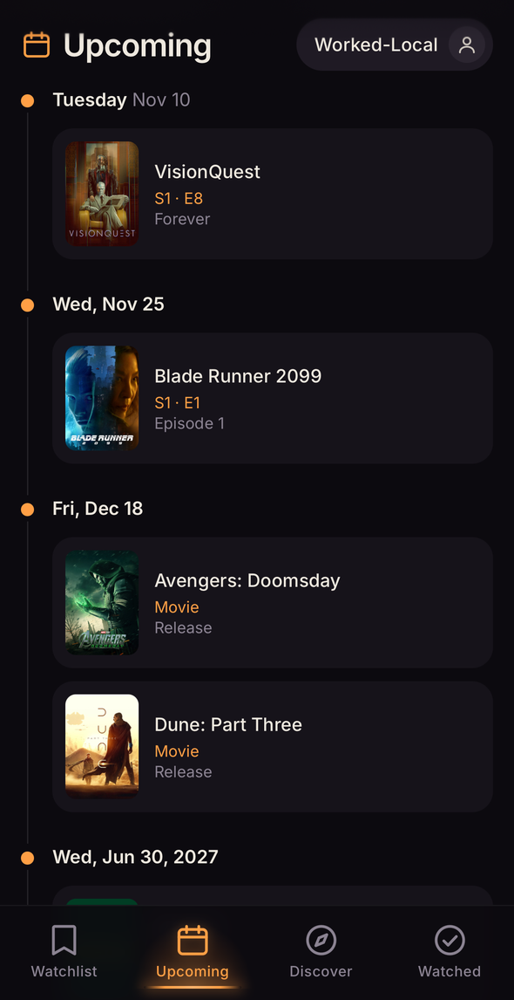
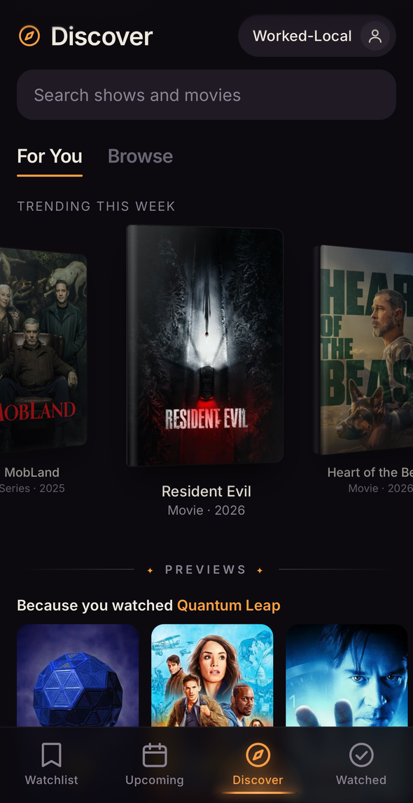
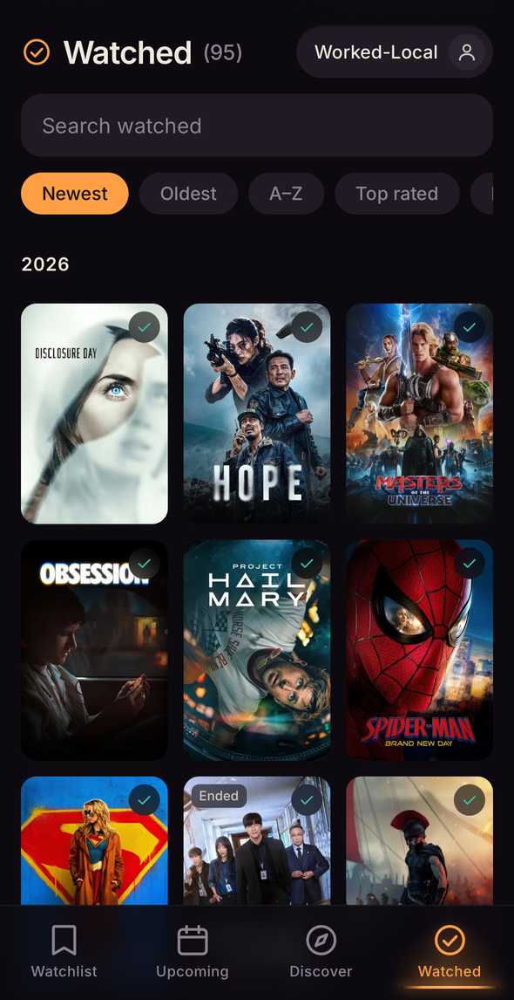
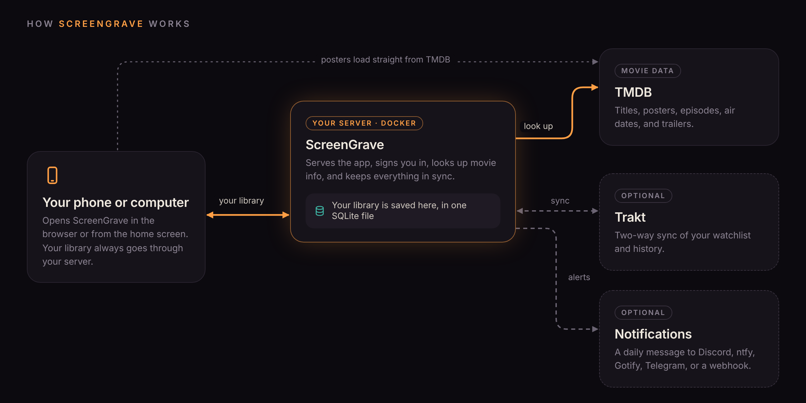

<p align="center">
  
</p>

<h1 align="center">ScreenGrave</h1>

<p align="center"><em>Track the shows and movies you love, in a clean, cinema-dark interface.</em></p>

<p align="center"><strong>Version 1.0.0</strong> · React + TypeScript · Node + SQLite · Docker · Installable PWA</p>

<p align="center">
  
  
  
  
  
</p>

ScreenGrave is a minimal, mobile-first tracker for TV shows and movies. It is inspired by the clean look of Hobi and built as a calmer alternative to Trakt's busy interface. It runs on your own server in Docker, keeps your library in a small SQLite database, and can sync both ways with Trakt. Posters, trailers, genres, ratings, and episode data come from [TMDB](https://www.themoviedb.org/).

**Contents:** [How it works](#how-it-works) · [Features](#features) · [Upcoming and in development](#upcoming-and-in-development) · [Security and privacy](#security-and-privacy) · [Tech stack](#tech-stack) · [Getting API keys](#getting-api-keys) · [Install with Docker](#install-with-docker) · [Development](#development) · [Project layout](#project-layout) · [Changelog](#changelog) · [Credits](#credits) · [License](#license)

---

## How it works



Your phone or computer opens ScreenGrave from **your own server**, where your whole library is saved in one small database file. Movie and show info comes from TMDB, and Trakt sync and daily notifications are optional. **More detail:** [docs/how-it-works.md](docs/how-it-works.md).

---

## Features

### Watchlist (landing page)
- Two boxes, **Movies** and **TV Shows**, each collapsible. The app remembers which ones you collapsed.
- Each box grows to 3 rows of posters, then scrolls on its own. Empty boxes stay slim.
- Progress bar and "x / y eps" on shows you haven't caught up with. Those shows sort first.
- "Not out yet" overlay with the release date on unreleased titles.
- Status icons on posters: eye (watching), check (watched), bookmark + clock (not out yet), bookmark + play (out now, not started).

### Smart Watchlist
- The Watchlist only holds what you still need to watch.
- Caught up on a show? It moves to Watched. If it's still running and a next episode is announced, it also appears in Upcoming.
- When new episodes air for a show in Watched, it moves back to the Watchlist with a progress bar.
- Put a caught-up show back on the Watchlist yourself (for a rewatch) and it stays there.

### Upcoming
- A timeline of new episodes and movie releases, grouped by day (Today, Tomorrow, weekday, date). Dates in another year show the year.
- Shows every episode coming up in the next **2 weeks**, with a **Show 4 weeks** button when there's more. Episodes released on the same day are combined into one row ("S5 · E1–E4"). Shows further out list their next episode.
- Follows your Watchlist plus caught-up shows in Watched, so their next episodes still appear.

### First-run walkthrough
- Pick the genres you like, tap what you've already seen, and choose the shows you're watching and the season you're on (earlier seasons get checked off).
- Or skip all that and **import from Trakt** instead. Every step is optional.

### Discover
- Search with Google-style suggestions. Tap a suggestion to open its details right away.
- Two tabs, remembered between visits: **For You** and **Browse**.
- **For You:** "Because you watched…" rows based on titles you finished, and "Top picks in…" rows for your favorite genres (a different mix each visit). Anything already in your library is left out.
- **Trending carousel** with 3D DVD-box covers. It loops endlessly, supports swipe and mouse drag (with momentum), has arrow buttons on desktop, and gives a gentle swipe hint after 3 seconds.
- **Browse** by Movies or Series, by **streaming service** (Netflix, Prime Video, Apple TV+, Disney+, and more), and by **genre**. Filters combine, for example "Popular on Hulu · Comedy".
- **Popular in your country:** the flag tile shows what's popular to stream where you live.
- Shows 6 rows at a time with a **Load more** button.
- Floating **search** button (hidden while the search bar is on screen), plus a **scroll-up** button once you're a few rows down, which jumps back to the For You and Browse tabs.

### Watched
- Search, plus sorting by Newest, Oldest, A-Z, Top rated, or Recently watched.
- Year headers that stay pinned while you scroll, and a floating search button.

### Detail sheet
- Backdrop, poster, overview (long ones fold to 4 lines with **Read more**), genres, and an audience rating chip.
- **Trailer** button that plays inside the app.
- **Watchlist / Watched** toggles. They show "(Added)" when active, and a short "Removed from..." message when you tap again.
- Season and episode tracker. It opens on the season you're currently on, with "Mark season watched".
- Finishing a season, or catching up on a whole show, gets a small celebration.
- Marking a show **Watched** checks off every aired episode in every season.
- Close with the X button or by tapping the blurred background. The page behind stays put.

### Sign-in
- **First-run setup:** pick your name and how to sign in: a **PIN** (4 to 8 numbers, recommended), a **password**, or **no sign-in** (with a warning).
- Stays signed in for 30 days. Wrong guesses are throttled, and changing your PIN or password signs out every other device.
- Prefer config files? `APP_PASSWORD` in `.env` still works and takes over from the in-app choice.

### Trakt
- **Connect Trakt** in the user menu shows a short code: enter it at trakt.tv on any device and you're connected. No redirect address or HTTPS needed, so it works on a plain local network too.
- **Two-way sync:** what you add, remove, or check off in ScreenGrave is sent to Trakt within seconds, removals included. Changes are batched and retried if Trakt is down.
- The first sync pulls in your Trakt history and watchlist, then uploads anything Trakt was missing, without duplicate plays.
- Titles you remove stay removed: the next sync won't bring them back unless you watch them again on Trakt.
- Smart Watchlist moves stay inside ScreenGrave and never touch your Trakt watchlist.
- Your Trakt login and TMDB key stay on the server and are never sent to the browser.

### Notifications
- One daily message with new episodes of shows you follow and Watchlist movies released that day, at the hour you pick.
- Sends to **Discord, ntfy, Gotify, Telegram**, or any **webhook**. Nothing is sent on quiet days, and nothing twice.

### Settings
- Display name, sign-in method, Trakt status and two-way sync, favorite genres, notifications, and your **country** (used for release dates and the streaming services on Discover).

### Look and feel
- "After-hours cinema" theme: plum-black surfaces, ember-amber accent, teal for done states.
- Popcorn-bucket tombstone app icon for the browser tab and the iPhone home screen.
- Icon tab bar with a soft amber glow that slides to the tab you're on, page titles with matching icons, tap ripple and sparkle, slide-up sheets, film-themed section dividers.
- Soft poster-shaped placeholders while things load.
- Respects the "reduce motion" setting, and shows a matching amber focus ring for people who use a keyboard.
- Installed copies update themselves: after a new version is deployed, the app notices and reloads once.
- Light and quick: the first screen loads on its own, and the rest of the app follows quietly in the background.

*ScreenGrave hides a few surprises. Try quoting your favorite movies in the Discover search.*

---

## Upcoming and in development

| Feature | Status |
| --- | --- |
| Google (Gmail) sign-in | Upcoming |
| Multi-user accounts | Upcoming |
| Sign in with Face ID or Touch ID (passkeys, HTTPS installs only) | Maybe later, if requested |

---

## Security and privacy

- **No analytics, tracking, or telemetry.** Your library stays in one SQLite file on your own server.
- PINs and passwords are stored only as scrambled fingerprints. Sign-in pauses after repeated wrong guesses, and changing your PIN signs out other devices.
- Your TMDB key and Trakt login never reach the browser.
- Other websites can't make changes on your behalf, and pages can't be embedded or loaded with outside scripts.
- The Docker image runs as a regular user and contains only Node.js, the built app, and one server file.

**Details:** [docs/security.md](docs/security.md) covers what's stored, what leaves your server, how sign-in is protected, and advice for running ScreenGrave on the internet.

---

## Tech stack

- **Web app:** Vite, React, TypeScript, Tailwind CSS v4, `vite-plugin-pwa`, Inter font
- **Server:** Node.js 24 with [Hono](https://hono.dev/), and Node's built-in SQLite (`node:sqlite`), bundled into a single file with esbuild for production
- **Packaging:** Docker image (Node 24 Alpine, no `node_modules` at runtime) with Docker Compose, built for amd64 and arm64 by GitHub Actions and published to GitHub's container registry
- **Data:** TMDB API for titles and artwork, Trakt API for sync
- Your library lives in `data/screengrave.db` on the server, shared by every device you sign in from

---

## Getting API keys

ScreenGrave needs a free TMDB key. Trakt is optional and only needed for Trakt sync.

### TMDB (required)

1. Create a free account at [themoviedb.org](https://www.themoviedb.org/) and sign in.
2. Go to **[Request an API key](https://www.themoviedb.org/settings/api/request)** and choose **Developer**.
3. Fill in the form. "Personal use" for a self-hosted tracker is fine.
4. Back on your API settings page, copy the **API Read Access Token**. It's the long one that starts with `eyJ`, not the short "API Key".
5. Put it in `.env.local` as `TMDB_TOKEN`.

### Trakt (optional)

1. Sign in at [trakt.tv](https://trakt.tv/), then open the **[Trakt developer apps page](https://developer.trakt.tv/apps)**.
2. Create a new app and give it any name, for example "ScreenGrave". A development app is fine, since you're its owner.
3. Open the app's **Credentials** and copy the **Client ID**. No client secret is needed.
4. Put it in your settings file as `TRAKT_CLIENT_ID`.

That's it. ScreenGrave signs in to Trakt with a short code, so you don't need to register a redirect URI.

> Optional: the menu also offers a redirect-based sign-in. Trakt development apps only allow `localhost` redirect addresses, so that method is mainly useful for local development.

---

## Install with Docker

The quickest way to run ScreenGrave is on a Linux server on your home network:

```bash
mkdir screengrave && cd screengrave
curl -fsSLO https://raw.githubusercontent.com/worked-locally/ScreenGrave/master/docker-compose.yml
curl -fsSL -o .env https://raw.githubusercontent.com/worked-locally/ScreenGrave/master/.env.example
nano .env                # fill in TMDB_TOKEN, and optionally TRAKT_CLIENT_ID
docker compose pull && docker compose up -d
```

The image is built by GitHub for every release, for both amd64 and arm64 (Raspberry Pi included). Prefer building it yourself? `git clone` the repo and run `docker compose up -d --build` instead.

Then open `http://<server-ip>:8787` on any device on your network and choose how to sign in. Do this right away, since the first person to open it gets to choose.

**Full guide:** [docs/install.md](docs/install.md), covering settings, connecting Trakt, updating, and backups.

---

## Development

Requires [Node.js](https://nodejs.org/) **24 or newer** (for the built-in SQLite).

```powershell
npm install
```

Create a file named `.env.local` in the project root:

```
TMDB_TOKEN=your_tmdb_read_access_token
TRAKT_CLIENT_ID=your_trakt_client_id
```

The first time you open the app, it asks how you want to sign in. Add `AUTH_DISABLED=true` to skip sign-in entirely while developing.

> Your development database is separate from your server's. If it's connected to the same Trakt account, Sync Now uploads whatever it holds, so disconnect Trakt there if it's only test data.

Then:

```powershell
npm run dev       # web app at http://localhost:5173, plus the server on 8787
npm run build     # type check, then build the app into /dist and the server into /dist-server
npm start         # runs the built version at http://localhost:8787 (run npm run build first)
npm run lint      # code checks
```

> `.env.local`, `.env`, and `data/` are gitignored, so never commit them. `TMDB_TOKEN`, `TRAKT_CLIENT_ID`, and the password stay on the server and are never sent to the browser.

The version number lives only in `package.json`. The app and server both read it from there.

---

## Project layout

```
server/         index.ts (server), api.ts (library), auth.ts (sign-in), security.ts, settings.ts,
                trakt.ts (two-way Trakt sync), notify.ts (notifications), tmdb.ts, db.ts (SQLite)
scripts/        build-server.mjs (bundles the server for production)
.github/        workflows/docker-image.yml (builds and publishes the Docker image for each release)
src/
  components/   Poster, TabBar, DetailSheet, EpisodeTracker, Carousel3D, UserMenu, SettingsSheet, ...
  screens/      Watchlist, Upcoming, Discover, Watched, Login, Setup, Onboarding
  lib/          api.ts, auth.ts, trakt.ts, tmdb.ts, library.ts, settings.ts, foryou.ts, freshness.ts, ...
public/         app icons
docs/           install guide, how it works, security and privacy, images and screenshots
data/           screengrave.db (created on first run, local development)
Dockerfile, docker-compose.yml, .env.example
```

---

## Changelog

<details open>
<summary><strong>1.0.0 (Day 7, part 2): first public release</strong></summary>

**New**
- **Ended and Canceled labels** on the posters of shows that have finished, in the top-left corner.
- **Show status** in the detail sheet: *Ongoing · next episode Wed, Nov 11*, *Ongoing · between seasons*, *Coming soon*, *Ended*, or *Canceled*.
- **Upcoming** shows a different light-hearted line while it refreshes your shows.
- **Ready-made Docker images**, built by GitHub for every release, for both amd64 and arm64 (Raspberry Pi included). Install and update with `docker compose pull`, with no git or build needed.
- **Open source** under the GNU AGPL-3.0, with a **Source code** link in **Settings → About**.

**Docs**
- New [How it works](docs/how-it-works.md) page, with a brief diagram in this README and a detailed one on the page.
- Install guide: the ready-made image is now the main way to install, building from source is the alternative, and there are notes on staying on one version.

**Fixes**
- On iPhone, tapping the floating search button now brings up the keyboard right away.
- The small poster in the detail sheet no longer gets cut off by the banner, and the banner is a bit shorter.

**Small things**
- The detail sheet is announced properly to screen readers like VoiceOver.
- The data volume always has the same name, whatever folder you install into.
- New screenshots of all five screens at the top of this page.

</details>

<details>
<summary><strong>0.9.0 (Day 7)</strong></summary>

**New**
- **Upcoming** shows every episode in the next 2 weeks, with **Show 4 weeks** when there's more. Same-day drops are combined into one row.
- **Celebration** when you finish a season or catch up on a show.
- **Loading placeholders** instead of "Loading…" text.
- **Tab bar glow:** a soft amber light slides to the tab you're on.
- **Detail sheet:** long overviews fold to 4 lines with **Read more**, and the close button is bigger and easier to tap.
- A few small surprises.

**Lighter and faster**
- The server is pre-built into one file, so the Docker image no longer carries `node_modules` or a TypeScript loader, and it now uses Node's smaller Alpine base. In testing, the server used about half the memory.
- The first screen loads on its own (main script 99 KB → 77 KB compressed), and the other screens follow in the background.
- Fonts trimmed to the Latin sets the app uses (218 KB → 133 KB).
- Tidier code: duplicate helpers merged, the old browser-storage migration removed, and the code checks now pass with no findings.

**Security**
- Changes are only accepted from ScreenGrave's own pages, not from other websites.
- Browser protections on every page (Content Security Policy, no embedding in other sites, and more).
- An extra limit on wrong sign-in tries across all devices combined.
- Requests over 2 MB are refused, and outside services time out instead of hanging.
- Signed-in data is never cached. Expired sessions are cleaned up hourly.
- New page: [docs/security.md](docs/security.md).

**Fixes**
- Discover: the scroll-up button appears after the 4th row instead of only at the very bottom.
- No more plain white outline after clicking a button on a computer.
- For You no longer shows loading shapes forever when TMDB can't be reached.

</details>

<details>
<summary><strong>0.8.0 (Day 6, part 2)</strong></summary>

**New**
- **First-run walkthrough:** pick favorite genres, mark what you've already seen, and add the shows you're watching with the season you're on. Or import from Trakt instead. Existing libraries only get the genre step.
- **For You** on Discover: "Because you watched…" and "Top picks in…" rows, skipping anything already in your library. The trending carousel lives here now.
- **Browse** keeps the filters, plus a new **Popular in your country** tile.
- Discover remembers whether you were on For You or Browse.
- **Favorite genres** in Settings.
- Install guide: how to add ScreenGrave to the iPhone home screen, including the plain-HTTP workaround (turn off **Open as Web App**).

</details>

<details>
<summary><strong>0.7.0 (Day 6)</strong></summary>

Includes 0.6: ScreenGrave now runs on a home server over HTTPS behind a reverse proxy with a wildcard Let's Encrypt certificate.

**New**
- **Settings** screen: display name, sign-in, Trakt, notifications, region, and About.
- **First-run setup:** choose a PIN (recommended), a password, or no sign-in. Change it any time in Settings. `APP_PASSWORD` in `.env` is now optional and `APP_USERNAME` is no longer needed.
- **Two-way Trakt sync:** watchlist changes, watched movies, and checked-off episodes are sent to Trakt, removals included. Can be turned off in Settings.
- One-time upload of anything Trakt was missing, with no duplicate plays.
- **Notifications** for new episodes and releases: Discord, ntfy, Gotify, Telegram, or a webhook, once a day at the hour you choose.
- **Region** setting for release dates and streaming services (defaults to the US).

**Fixes**
- Sync no longer brings back titles you removed in ScreenGrave.
- Smart Watchlist moves are no longer treated as your own changes.
- Movie release dates now use your country's theatrical date.
- iPhone: page content no longer shows behind the status bar, and the tab bar stays put on short pages.
- Floating search and scroll-up buttons respond to the first tap.
- Watched: the scroll-up button now appears after the fourth row of posters.
- Discover: the scroll-up button lands on the browse filters in one tap.
- Installed apps no longer get stuck on an old version after an update.

</details>

<details>
<summary><strong>0.5.0 (Day 5)</strong></summary>

**New**
- Docker packaging: a `Dockerfile` (Node 24 slim, health check, runs as a non-root user) and `docker-compose.yml` with a data volume and auto-restart.
- Runs on plain HTTP on port 8787 by default, so it works on a home network with no domain or certificate.
- Trakt **device sign-in**: Connect Trakt shows a short code to enter at trakt.tv. No redirect address needed, so it works on any address, including LAN IPs over HTTP.
- Tap the code to copy it, with a fallback that also works on plain-HTTP pages and iPhone Safari.
- The redirect sign-in is still available as an option, and its redirect address is now worked out automatically from the address you're using.
- New install guide: [docs/install.md](docs/install.md).

**Improvements**
- The version number now lives only in `package.json`. The About screen, the health check, and the server all read it from there.
- The server shuts down cleanly when Docker stops it, so the database closes properly.
- The Docker image only contains what the server needs at runtime.
- `.env` (the Docker settings file) is gitignored, and `.env.example` documents every setting.

**Found during testing**
- Trakt development apps only accept `localhost` redirect addresses, which is why device sign-in is now the default.

</details>

<details>
<summary><strong>0.4.5 (Day 4, part 2)</strong></summary>

**New**
- Sign-in page with a password and a 30-day session (HttpOnly cookie). Repeated wrong passwords are throttled.
- Trakt connect (OAuth with PKCE, handled on the server) and import of watched movies, watched shows with episode progress, and your Trakt watchlist.
- Working Sync Now, with "last synced" shown in the menu.
- Smart Watchlist: caught-up shows move to Watched, and come back automatically when new episodes air.
- Upcoming now follows caught-up shows in Watched, so their next episodes still appear.
- Popcorn-bucket tombstone app icons for the browser tab, the iPhone home screen, and the PWA install.

**Bug fixes**
- Trakt's watched list no longer includes episode details, so episode progress is now imported per show.
- Line endings are now consistent (LF), which ends the CRLF warnings on Windows.

</details>

<details>
<summary><strong>0.4.0 (Day 4)</strong></summary>

**Bug fixes**
- Floating search button no longer hides behind the scroll arrows on desktop, and it now stays hidden while the search bar is on screen.
- Upcoming shows the year for dates outside the current year, like "Fri, Jan 15, 2027".
- Removed a leftover unused variable that would have broken production builds.

**Improvements**
- Floating search button on the Watched page.
- Over 30 film-themed divider phrases.
- Page titles now show their tab-bar icon.

**Backend (new)**
- Added a small server (Hono) that serves the app and passes TMDB requests through, so the TMDB token is no longer in the browser code.
- Library and episode progress are now stored in SQLite (`data/screengrave.db`), shared across every browser and device that uses the server.
- Data saved in a browser before this version is uploaded to the server automatically the first time that browser opens the app.
- One `npm run dev` starts both the web app and the server, and `npm run build` then `npm start` runs it in production mode.

</details>

<details>
<summary><strong>0.3.0 (Day 3)</strong></summary>

**Bug fixes**
- The page behind the detail sheet no longer jumps to the top when a title opens. Your scroll position is kept and restored.
- The detail sheet now opens on your current unfinished season instead of Season 1.
- Floating section titles on the Watchlist now stay pinned flush to the top of their box.
- Carousel: smooth endless loop, no blank space at the edges, momentum when dragging with a mouse.
- Discover is limited to 6 rows at a time, with Load more.
- More padding at the top and bottom of every page.
- Faster tap effect.

**Improvements**
- Watchlist split into collapsible Movies and TV Shows boxes with film-themed dividers.
- "Not out yet" overlay on unreleased titles.
- Icon-first tab bar with centered labels.
- Rating chip next to the Trailer button, and genres under the overview.
- X close button on the detail sheet.
- Temporary user menu at the top right.
- Floating search and scroll-up buttons on Discover.
- Arrow buttons on every horizontally scrollable row (desktop).
- Swipe hint on the trending carousel.
- Smaller, parenthesized counts in page titles, such as Watchlist (12).

</details>

<details>
<summary><strong>0.2.0 (Day 2)</strong></summary>

- Watchlist as the landing page, with progress bars and a new Upcoming timeline tab.
- Search suggestions, in-app trailers, and Watchlist / Watched toggles.
- Status icons on posters, and a Watched page with search, sorting, and year headers.
- Discover redesign: 3D DVD-box carousel, streaming-service and genre filters.
- Marking a show Watched now checks off all of its episodes.
- Amber and teal theme, blurred sheet backdrop, tap effects, Inter font.
- Fixed poster alignment on the Watchlist.

</details>

<details>
<summary><strong>0.1.0 (Day 1)</strong></summary>

- Project setup with TMDB search and trending.
- Watchlist and Watched lists, saved locally.
- Season and episode tracking.
- PWA manifest so it installs on a phone's home screen.

</details>

---

## Credits

Data and images provided by TMDB. This product uses the TMDB API but is not endorsed or certified by TMDB. Trakt sync uses the Trakt API.

---

## License

ScreenGrave is free and open source under the **[GNU Affero General Public License v3.0](LICENSE)** (AGPL-3.0).

In short: you can use it, change it, and share it. If you share a modified version, or run one for other people over a network, you must make your changes available under the same license. Improvements stay open for everyone.

Copyright © 2026 Worked-Locally
